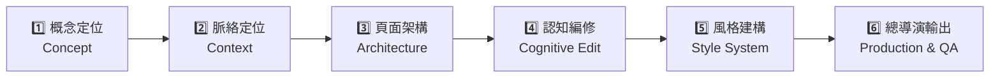
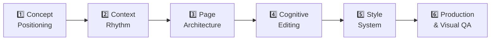

# 🎓 SOIL 教學簡報技能集（`soil-deck-skills`）— AI & Language Learning 課堂中英雙語指南
# 🎓 SOIL Teaching Deck Skills (`soil-deck-skills`) — Bilingual Student & Classroom Guide

> 🌐 **[🇹🇼 中文版說明與安裝指南（請往下捲動）](#-第一部分中文版使用說明與安裝指南-traditional-chinese)** ｜ **[🇺🇸 Click Here for English Usage & Installation Guide](#-part-2-english-usage--installation-guide)**
>
> 📄 **進階完整教學手冊 / Standalone Deep-Dive Tutorials**:
> - 📘 [中文完整教學講義 (`docs/TUTORIAL_ZH.md`)](./docs/TUTORIAL_ZH.md)
> - 📗 [English Complete Tutorial (`docs/TUTORIAL_EN.md`)](./docs/TUTORIAL_EN.md)

---

## 🇹🇼 第一部分：中文版使用說明與安裝指南 (Traditional Chinese)

### 一、 這套 Skill 是什麼？為什麼做教學簡報要用它？

一般用 AI 做簡報時，AI 常會把整段課文直接塞進投影片，做出「字超多、沒有教學節奏、學生抓不到重點」的條列摘要頁。

**`soil-deck-skills`（SOIL 教學簡報技能集，改編自 `mathruffian-dot/soil-deck-skills`）** 以李俊儀教授的 **SOIL Teaching Deck Workflow 六顆引擎心法** 與認知負荷理論為核心，規定 AI **「先想清楚教什麼、怎麼幫學習者搭鷹架，最後才動手生投影片」**：



1. **引擎一：概念定位（Concept Positioning）** — 抓出 **1 個總概念**、**3 個子概念**、**3 個學習者常見誤解（❌ 迷思 ➔ ✅ 正解）**、**帶走一句話（Takeaway）**，並區分「哪些放投影片、哪些留給口頭講稿」。
2. **引擎二：脈絡定位（Context Positioning）** — 安排三段式教學節奏：**引起動機 Hook（15–20%）➔ 維持注意 Build Understanding（60–70%）➔ 喚起行動 Call to Action（15–20%）**。
3. **引擎三：頁面架構（Page Architecture）** — 拒絕無聊的條列頁！為每一頁指派明確的教學角色（封面頁、問題引入頁、迷思澄清頁、雙欄比較頁、步驟流程頁、案例頁、總結頁、Your Turn 行動頁），並嚴守 **「一頁一重點」**。
4. **引擎四：認知編修（Cognitive Editing）** — 用六個認知工具替投影片減肥與搭鷹架：**降雜訊、區塊化、增資訊、結構化、順脈絡、步驟化**。
5. **引擎五：風格建構（Style Construction）** — 鎖定全簡報一致的配色、海報級字級階層、版面格線與插畫風格（YAML 設計規格）。
6. **引擎六：總導演輸出與檢驗（Production & Visual QA）** — 自動產出可編輯 `.pptx` 或單一離線互動 `.html` 網頁簡報，並做版面防溢出檢查。

---

### 二、 內含 3 個技能差在哪裡？我該選哪一個？

安裝本技能包後，你的 AI Agent 會同時獲得 **3 個 SOIL 簡報技能**。請依你的課堂任務需求選擇：

| 技能名稱 | 產出檔案格式 | 核心特色 | 最適合的使用情境（AI & Language Learning） |
| :--- | :--- | :--- | :--- |
| **`soil-html-deck`**<br>🌟 *課堂互動首選* | **單一互動網頁檔**<br>（`.html`，離線可開） | • 真實 HTML/CSS/JS 文字與互動元件<br>• 內建**點擊揭曉（Click-to-reveal）、前後對照切換、步驟引導器（Stepper）、頁籤、分類篩選、小測驗**<br>• 自動適應電腦投影與手機螢幕 | • 製作 **Microlearning 互動教學投影片**<br>• 文法迷思翻轉、單字語境比較、語用禮貌度對照<br>• 嵌入 Teaching Cockpit 或直接用瀏覽器打開操作 |
| **`soil-teaching-deck`**<br>📘 *PowerPoint 必備* | **可編輯簡報檔**<br>（`.pptx`） | • 產出文字、色塊、表格皆可在 PowerPoint / Google Slides 自由修改的 `.pptx`<br>• 支援**「從零做簡報」**與**「診斷並改進現有 `.pptx` 簡報」**兩種模式 | • 上台口頭報告（Presentation）需要可編輯 `.pptx`<br>• 把教案（Lesson Plan）或教材文件轉成結構化投影片<br>• 請 AI 幫你診斷舊簡報哪裡「字太多、認知負荷太高」並自動改版 |
| **`soil-image-deck`**<br>🎨 *全視覺海報風* | **全圖片／底圖簡報檔**<br>（`.pptx`） | • 類似 NotebookLM 視覺簡報，每頁由 AI 生圖驅動<br>• 支援 **`baked`（文字直接繪入滿版圖）**與 **`plate`（AI 設計留白底圖＋疊加可編輯文字）**<br>• 透過「黃金樣張（Golden Sample）」鎖定全份畫風 | • 製作高視覺衝擊力的開場介紹、故事繪本風語言教材、海報式微學習卡片<br>*(註：需搭配支援內建生圖的 Agent 或生圖 API)* |

---

### 三、 Step 0：先建一個專案資料夾（每份簡報一個）

安裝技能只要做一次，在哪裡裝都一樣；但**製作簡報時，AI 只讀得到你目前打開的資料夾**，做出來的 `.html`、`.pptx` 也會存在這個資料夾裡。所以開始做簡報之前，請先：

1. 在桌面建立一個**英文名稱、沒有空格**的資料夾，例如 `Week12_Deck`（整個路徑最好也不要有中文）。如果要改造現有的 `.pptx`（範本 3），先把它**複製**一份放進去。
2. 用 AI Agent 打開這個資料夾：**Antigravity** 用 **New Project** 選這個資料夾；**OpenCode** 在這個資料夾裡啟動。
3. 開一個**新對話**，再進行下面的安裝與製作。

做完後，簡報檔都在這個資料夾裡，交作業時直接從這裡拿。

---

### 四、 Step 1：如何安裝？（只需做一次，支援 Antigravity / OpenCode / Claude Code / Codex）

你**完全不需要自己開終端機找資料夾路徑**！只要打開你正在使用的 AI Agent（**Google Antigravity** 或 **OpenCode**），複製下方對應的一段話貼進對話框，AI 就會自動幫你把 3 個技能全部安裝好。

#### 💬 複製貼給 AI Agent 自動安裝

##### 選項 1：通用一鍵安裝指令（同時安裝到 Antigravity、OpenCode、Claude Code 與 Codex）
直接複製以下**整段話**貼給你的 **Antigravity** 或 **OpenCode**：
```text
請幫我把 https://github.com/MeiChen-ai/soil-deck-skills.git 完整 clone 到暫存資料夾，並執行裡面的安裝腳本（或把 skills/ 底下的 soil-teaching-deck、soil-html-deck、soil-image-deck 三個完整資料夾複製到 ~/.gemini/config/skills/、~/.config/opencode/skills/、~/.agents/skills/ 與 ~/.claude/skills/，若資料夾不存在請自動建立），確認 SKILL.md、references/、scripts/ 與 assets/ 都完整包含。
```

##### 選項 2：如果你只用 Google Antigravity
```text
請幫我把 https://github.com/MeiChen-ai/soil-deck-skills.git 完整 clone 下來，並將 skills/ 底下的 soil-teaching-deck、soil-html-deck、soil-image-deck 三個完整資料夾複製到我的 ~/.gemini/config/skills/ 目錄下（若資料夾不存在請自動建立），確認裡面的 SKILL.md、references/、scripts/ 與 assets/ 都完整保留。
```

##### 選項 3：如果你只用 OpenCode
```text
請幫我把 https://github.com/MeiChen-ai/soil-deck-skills.git 完整 clone 下來，並將 skills/ 底下的 soil-teaching-deck、soil-html-deck、soil-image-deck 三個完整資料夾同時複製到我的 ~/.config/opencode/skills/ 與 ~/.agents/skills/ 目錄下（若資料夾不存在請自動建立），確認裡面的 SKILL.md、references/、scripts/ 與 assets/ 都完整保留。
```

---

### 五、 Step 2：裝好後怎麼確認與呼叫？

1. **在 Google Antigravity 中**：
   * 安裝完成後，請**開啟一個新的對話視窗（New Conversation）**。
   * 在對話框輸入 `/` 即可看到 `/soil-html-deck`、`/soil-teaching-deck`、`/soil-image-deck`，或在對話中直接點名要使用哪一個技能。
2. **在 OpenCode / Claude Code / Codex 中**：
   * 在你的專案資料夾打開 Agent，直接在 Prompt 中寫明**「請使用 `soil-html-deck`（或 `soil-teaching-deck` / `soil-image-deck`）技能…」**，或寫進專案的 `AGENTS.md` 中即可自動觸發。

---

### 六、 Step 3：課堂實戰 Prompt 範本（直接複製修改 `【...】` 即可使用）

#### 📋 範本 1：用 `soil-html-deck` 製作「可點擊互動的 HTML 微學習投影片」
> **適用情境**：把你的語言教學主題（單字、文法、語用、閱讀策略）做成一份在瀏覽器打開就能點擊互動的 `.html` 教學簡報。

```text
請使用 soil-html-deck 技能，幫我把以下語言學習主題做成一份 8–10 頁的單一檔案互動教學投影片（.html）：
- 教學主題：【例如：CEFR B1/B2 職場禮貌請求（Polite Requests & Hedging in Emails）】
- 教學對象與時間：【例如：大學英語學習者，8 分鐘微學習單元（Microlearning）】
- 投影片顯示語言：【全英文（English） / 中英雙語輔助】
- 希望包含的互動設計：
  1. 迷思翻轉頁（❌ Too Blunt 直白句 vs. ✅ Appropriate 禮貌句，提供點擊揭曉或切換比較）
  2. 步驟拆解頁（Stepper 一步步引導學習者觀察語用策略）
  3. 最後 1–2 頁放「Your Turn」互動練習題（點選選項後給即時回饋，答錯先給提示不直接給答案）
請先依 SOIL 流程給我「概念定位與每頁角色架構表」確認，確認後再產出單一離線可開的 HTML 檔！
```

#### 📋 範本 2：用 `soil-teaching-deck` 從零製作「可編輯 `.pptx` 教學簡報」
> **適用情境**：需要一份可以在 PowerPoint 或 Google Slides 裡打開編輯的 `.pptx` 投影片。

```text
請使用 soil-teaching-deck 技能，幫我把以下教材／主題製作成一份可編輯的 .pptx 教學簡報：
- 教學主題與素材：【貼上你的教案重點、文章或主題描述】
- 教學對象：【例如：台灣高中生 / 大學生（CEFR B1）】
- 預計講授時間：【例如：15 分鐘微教學（Micro-teaching）】
- 投影片語言：【例如：投影片以清楚簡短的英文為主，關鍵術語附中文】
請先帶我走 SOIL 引擎一（概念定位）到引擎四（頁面角色與認知編修），等我確認架構後，再用 PptxGenJS 幫我生成 .pptx 簡報檔！
```

#### 📋 範本 3：用 `soil-teaching-deck` 診斷並改造「現有 `.pptx` 簡報」
> **適用情境**：你手邊已經有一份自己或 AI 之前做的 `.pptx`，覺得字太多、版面太擠或不夠清楚，想請 AI 幫你診斷並重做。

```text
請使用 soil-teaching-deck 技能的「診斷修改模式」，幫我檢查資料夾裡的 `[你的簡報檔名.pptx]`：
1. 請先逐頁用 SOIL 引擎四的六個認知詞（降雜訊、區塊化、增資訊、結構化、順脈絡、步驟化）與引擎三（頁面角色）幫我產出「認知編修診斷報告」，標出高／中／低修改優先級。
2. 等我確認要修改哪幾頁後，再幫我輸出改版後的 .pptx！
```

#### 📋 範本 4：用 `soil-image-deck` 製作「視覺優先的全圖／底圖 `.pptx` 簡報」
> **適用情境**：想做一份像 NotebookLM 視覺簡報一樣、每頁都有統一插畫風格的高視覺感簡報。

```text
請使用 soil-image-deck 技能，幫我為【主題名稱】設計一份 8 頁的視覺教學簡報（output_mode 請用 plate 底圖疊字模式 / 或 baked 全圖模式）：
- 教學對象：【例如：大學通識課學生】
- 視覺風格偏好：【例如：溫暖水彩插畫風 / 清新扁平教育插畫風】
請先完成 SOIL 前四顆引擎與 YAML 規格，先生成黃金樣張讓我確認畫風後，再完成整份簡報！
```

---
---

## 🇺🇸 Part 2: English Usage & Installation Guide

### 1. What Is `soil-deck-skills` & Why Use It for Language Teaching?

When you ask a generic AI to "make slides," it usually dumps walls of bullet points onto every slide—creating high cognitive load and passive reading rather than active learning.

**`soil-deck-skills`** (adapted from `mathruffian-dot/soil-deck-skills`) is built on Prof. Chun-Yi Lee's **SOIL 6-Engine Teaching Deck Workflow** and cognitive load theory. It trains your AI Agent to **think like an instructional designer before touching slide layouts**:



1. **Engine 1 — Concept Positioning**: Extracts **1 Big Idea**, **3 Sub-Concepts**, **3 Common Learner Misconceptions (❌ Myth ➔ ✅ Reality)**, **1 Takeaway Sentence**, and splits content into **On-Slide Visual Copy vs. Spoken Teacher Script**.
2. **Engine 2 — Context Positioning**: Organizes the deck into a 3-act learning rhythm: **Hook / Motivation (15–20%) ➔ Build Understanding (60–70%) ➔ Call to Action / Practice (15–20%)**.
3. **Engine 3 — Page Architecture**: Assigns every slide a clear pedagogical job (Cover, Question Hook, Myth-Busting Flip, Side-by-Side Comparison, Step-by-Step Process, Case Study, Summary, Your Turn Task) and enforces **Strictly One Core Point per Slide**.
4. **Engine 4 — Cognitive Editing**: Refines every slide through 6 cognitive lenses: **Reduce Noise, Chunking, Bridge Information, Visual Hierarchy, Reading Flow, and Stepwise Pacing**.
5. **Engine 5 — Style Construction**: Locks color palette, poster-grade typography hierarchy, alignment grids, and visual rules via a structured YAML spec.
6. **Engine 6 — Production & Visual QA**: Generates the final `.html` or `.pptx` deck and verifies layout, readability, and zero text overlap.

---

### 2. Which of the 3 Included Skills Should I Choose?

Installing this repository gives your AI Agent **3 specialized SOIL presentation skills**:

| Skill Name | Output Format | Key Features | Best Classroom Use Cases (AI & Language Learning) |
| :--- | :--- | :--- | :--- |
| **`soil-html-deck`**<br>🌟 *Best for Interactive Lessons* | **Single-File Interactive Web Deck**<br>(`.html`, works 100% offline) | • Live HTML/CSS/JS text and interactive widgets<br>• Built-in **click-to-reveal cards, before/after toggles, step-by-step steppers, tabs, category filters, decision trees, and mini-quizzes**<br>• Responsive on both desktop projectors and mobile screens | • Building **Interactive Microlearning Walkthroughs**<br>• Grammar noticing flips, vocabulary context clues, L2 pragmatics comparisons<br>• Embedding inside a Teaching Cockpit or opening directly in any browser |
| **`soil-teaching-deck`**<br>📘 *Best for Editable PowerPoints* | **Editable PowerPoint Deck**<br>(`.pptx`) | • Generates native text boxes, cards, tables, and shapes editable in PowerPoint / Keynote / Google Slides<br>• Supports both **Full Creation Mode** and **Diagnostic Revision Mode** (auditing & fixing an existing `.pptx`) | • Live oral presentations where you want an editable `.pptx`<br>• Turning a lesson plan or reading passage into structured teaching slides<br>• Diagnosing and redesigning text-heavy `.pptx` slides to lower cognitive load |
| **`soil-image-deck`**<br>🎨 *Best for Visual Storytelling* | **Full-Visual / Plate PowerPoint**<br>(`.pptx`) | • NotebookLM-style image-driven slides<br>• Supports **`baked` mode** (short text rendered inside full-page AI art) and **`plate` mode** (AI-designed background plates + editable text overlays)<br>• Locks visual consistency with a **Golden Sample** | • High-impact lesson hooks, visual storytelling, or workshop openers<br>*(Note: Requires an AI Agent with built-in image generation or an image API)* |

---

### 3. Step 0: Make a Project Folder First (One Folder per Deck)

You install the skills only once, and it does not matter which folder you are in. But **when you make a deck, the AI can only read the folder you have open**, and it saves the `.html` or `.pptx` file there. So before you make a deck:

1. On your desktop, create a folder with an **English name and no spaces**, e.g. `Week12_Deck` (avoid Chinese characters anywhere in the path). To redesign an existing `.pptx` (Template 3), **copy** it into this folder first.
2. Open this folder in your AI agent: in **Antigravity**, use **New Project** and choose this folder; in **OpenCode**, start it inside this folder.
3. Start a **new chat**, then install and build as described below.

When you finish, your deck files are in this folder, ready to submit.

---

### 4. Step 1: One-Time Installation (Supports Antigravity, OpenCode, Claude Code & Codex)

You do **not** need to manually locate any hidden folders! Just open your AI Agent (**Google Antigravity** or **OpenCode**), copy one of the blocks below, and paste it directly into the chat box.

#### 💬 Copy & Paste One Prompt to Your AI Agent

##### Option 1: Universal Install Prompt (Installs to Antigravity, OpenCode, Claude Code & Codex at Once)
Copy and paste this entire block into **Antigravity** or **OpenCode**:
```text
Please clone https://github.com/MeiChen-ai/soil-deck-skills.git into a temporary folder and run its installer script (or copy the three skill folders `soil-teaching-deck`, `soil-html-deck`, and `soil-image-deck` from `skills/` into `~/.gemini/config/skills/`, `~/.config/opencode/skills/`, `~/.agents/skills/`, and `~/.claude/skills/`, creating the directories if they do not exist). Make sure `SKILL.md`, `references/`, `scripts/`, and `assets/` are all preserved inside each skill folder.
```

##### Option 2: Google Antigravity Only
```text
Please clone https://github.com/MeiChen-ai/soil-deck-skills.git and copy the three skill folders (`soil-teaching-deck`, `soil-html-deck`, and `soil-image-deck`) from `skills/` into my global Antigravity skills directory at `~/.gemini/config/skills/` (create the directory if it does not exist), preserving all `SKILL.md`, `references/`, `scripts/`, and `assets/` subdirectories.
```

##### Option 3: OpenCode Only
```text
Please clone https://github.com/MeiChen-ai/soil-deck-skills.git and copy the three skill folders (`soil-teaching-deck`, `soil-html-deck`, and `soil-image-deck`) from `skills/` into both `~/.config/opencode/skills/` and `~/.agents/skills/` (create the directories if they do not exist), preserving all `SKILL.md`, `references/`, `scripts/`, and `assets/` subdirectories.
```

---

### 5. Step 2: How to Verify & Trigger the Skills

1. **In Google Antigravity**:
   * After installation, **start a new conversation**.
   * Type `/` in the chat box to see `/soil-html-deck`, `/soil-teaching-deck`, and `/soil-image-deck`, or mention the skill name directly in your prompt.
2. **In OpenCode / Claude Code / Codex**:
   * Open the agent in your project folder and mention **"Use the `soil-html-deck` (or `soil-teaching-deck` / `soil-image-deck`) skill..."** in your prompt or in your project's `AGENTS.md`.

---

### 6. Step 3: Ready-to-Use Classroom Prompt Templates

#### 📋 Template 1: Build an Interactive Single-File `.html` Microlearning Deck (`soil-html-deck`)
> **Use Case**: Turn a language learning topic (vocabulary, grammar, pragmatics, or reading skills) into a browser-ready `.html` deck with click-to-reveal cards, steppers, and practice questions.

```text
Please use the `soil-html-deck` skill to create an 8–10 slide interactive single-file HTML presentation (`.html`) for the following language learning topic:
- Topic: [e.g., CEFR B1/B2 Polite Email Requests & Hedging Strategies]
- Target Learners & Duration: [e.g., University EFL learners, 8-minute microlearning module]
- Slide Language: [English]
- Interactive Elements to Include:
  1. A myth-busting / comparison slide (❌ Too Blunt vs. ✅ Appropriate, with interactive toggle or click-to-reveal clues)
  2. A step-by-step guided walkthrough (Stepper component)
  3. 1–2 "Your Turn" practice slides at the end with instant hint-first feedback (give a clue on the first wrong try instead of revealing the answer immediately)
Please show me the SOIL Concept Positioning & Slide Architecture table for approval first before generating the standalone `.html` file!
```

#### 📋 Template 2: Build an Editable `.pptx` Teaching Presentation from Scratch (`soil-teaching-deck`)
> **Use Case**: Create a clean, structured PowerPoint (`.pptx`) presentation that you can edit in PowerPoint, Keynote, or Google Slides.

```text
Please use the `soil-teaching-deck` skill to build an editable `.pptx` teaching presentation in English:
- Topic & Source Material: [Paste your lesson plan, reading passage, or topic notes here]
- Target Audience: [e.g., High school / University EFL students at CEFR B1 level]
- Lesson Duration: [e.g., 15-minute micro-teaching demo]
Please guide me through SOIL Engine 1 (Concept Positioning) to Engine 4 (Page Architecture & Cognitive Editing) in English first. Once I approve the slide plan, generate the `.pptx` file using PptxGenJS!
```

#### 📋 Template 3: Diagnose & Redesign an Existing `.pptx` Deck (`soil-teaching-deck`)
> **Use Case**: Audit an existing PowerPoint file for cognitive overload and automatically produce a cleaner, better-structured version.

```text
Please use the Diagnostic Revision Mode of `soil-teaching-deck` to review `[your-slides.pptx]` in my workspace:
1. Analyze each slide using SOIL Engine 4's six cognitive editing principles (Reduce Noise, Chunking, Bridge Info, Hierarchy, Reading Flow, Stepwise Pacing) and Engine 3 (Page Roles), and give me a prioritized Cognitive Editing Report (High / Medium / Low priority).
2. Wait for my confirmation on which slides to revise, then generate the improved `.pptx` file!
```

#### 📋 Template 4: Create a Visual-First Image `.pptx` Deck (`soil-image-deck`)
> **Use Case**: Build a NotebookLM-style visual slide deck where every slide is driven by a consistent AI-generated illustration style.

```text
Please use the `soil-image-deck` skill to create an 8-slide visual teaching presentation on [Topic] (use `plate` mode for editable text overlays, or `baked` mode for full-image slides):
- Target Learners: [e.g., University EFL learners]
- Visual Style: [e.g., Warm watercolor educational illustration / Clean flat vector editorial style]
Please complete the SOIL concept and page plan, generate the YAML spec, and show me a Golden Sample slide to lock the style before generating the full deck!
```

---

### 7. Repository Structure & Credits

```text
soil-deck-skills/
├── README.md                                 # Bilingual Student & Classroom Guide (this file)
├── LICENSE                                   # MIT License
├── docs/
│   ├── TUTORIAL_ZH.md                        # Complete Traditional Chinese Tutorial & Engine Reference
│   └── TUTORIAL_EN.md                        # Complete English Tutorial & Engine Reference
├── install/
│   ├── install.ps1                           # Windows PowerShell 1-click installer (Antigravity/OpenCode/Claude/Codex)
│   └── install.sh                            # macOS / Linux Bash 1-click installer
├── scripts/
│   ├── install.ps1                           # Alias wrapper for install/install.ps1
│   └── install.sh                            # Alias wrapper for install/install.sh
└── skills/
    ├── soil-html-deck/                       # Skill 1: Interactive Single-File HTML Deck (.html)
    │   ├── SKILL.md
    │   ├── assets/interactive-spec-template.yaml
    │   ├── references/ (html-patterns.md, interaction-router.md, soil-deck-core.md, validation.md)
    │   └── scripts/ (validate_interactive_spec.py, embed_assets.py, verify_html.py)
    ├── soil-teaching-deck/                   # Skill 2: Editable Teaching PowerPoint (.pptx) + Diagnostic Mode
    │   └── SKILL.md
    └── soil-image-deck/                      # Skill 3: Visual-First Full-Image / Plate PowerPoint (.pptx)
        ├── SKILL.md
        ├── assets/soil-spec-template.yaml
        ├── references/ (soil-engines.md, soil-deck-core.md, layout-recipes.md, prompting.md, etc.)
        └── scripts/ (validate_spec.py, verify_images.py, pack_pptx.py)
```

* **Upstream Author & Core Methodology**: Adapted from [`mathruffian-dot/soil-deck-skills`](https://github.com/mathruffian-dot/soil-deck-skills), based on Prof. Chun-Yi Lee's (李俊儀教授) **SOIL Teaching Deck Workflow**.
* **Course Packaging & Bilingual Classroom Edition**: Packaged by **MeiChen-ai (Ya-mei Chen)** for the *AI and Language Learning* course.
* **License**: [MIT License](LICENSE).
